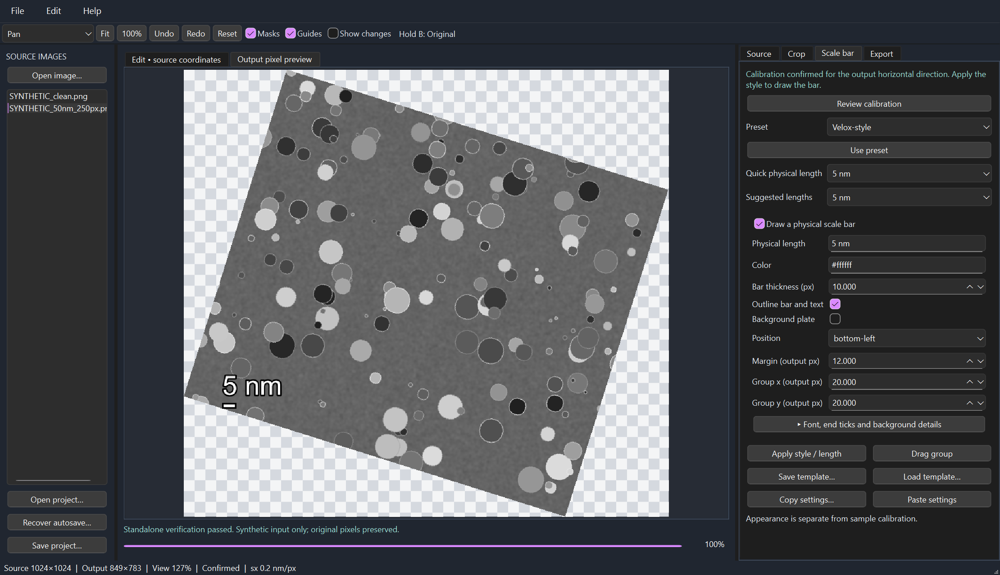
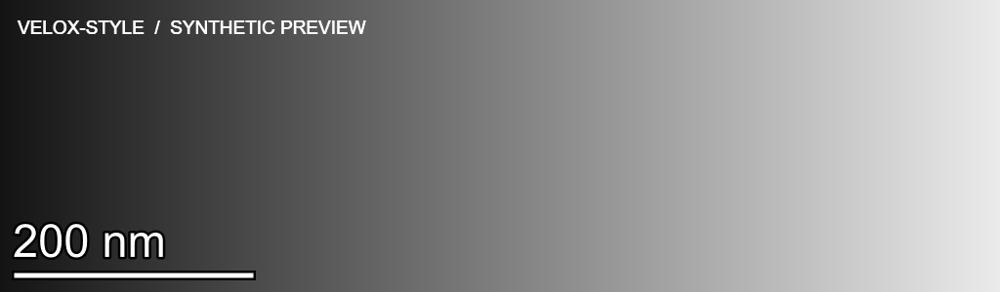
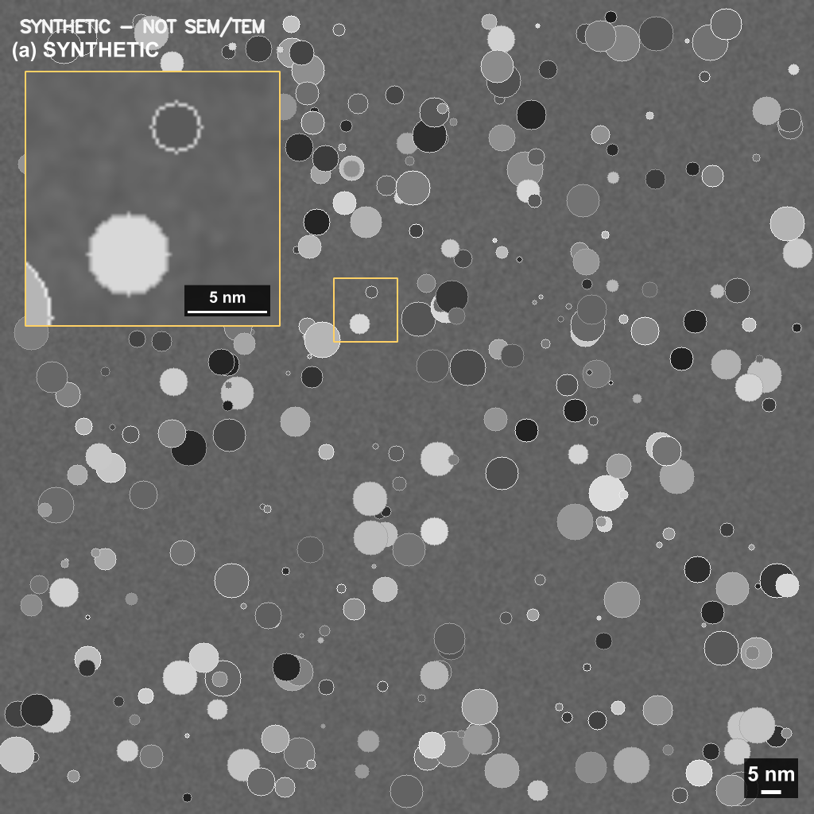

# MicroScale Editor

**A local desktop editor for calibrated, traceable SEM/TEM real-space images.**

Crop images, review calibration evidence, edit scale-bar annotations, create linked insets, and export presentation figures alongside preserved scientific data. The interface is English. Processing stays local, with no account, cloud service, or GPU required.

[Download for Windows](https://github.com/CapricciosoSZU/MicroScaleEditor/releases/latest) · [English manual](docs/USER_GUIDE.md) · [简体中文手册（zh-CN）](docs/USER_GUIDE.zh-CN.md) · [Build instructions](PACKAGING.md) · [Validation](VALIDATION.md)



> All publicly included images are explicitly **SYNTHETIC**. Private SEM/TEM files are used only for local validation; neither those images nor their filenames are published. See the validation record for the tested scope.

## Features

- **Calibration with evidence:** manual sample spacing, endpoint measurements, OME-TIFF physical sizes, local OCR candidates, and transfer from a matching reference. Calibration remains pending until reviewed and confirmed.
- **Shift-constrained calibration:** hold Shift while drawing or moving a calibration endpoint to keep the reference line horizontal. Release Shift for free placement.
- **Image rotation:** 90° left/right, 180°, and custom clockwise angles, with expanded output, horizontal scale labels, recorded transforms, and exact native quarter-turn data exports.
- **Source-format export by default:** keep TIFF/PNG/JPEG file type and original bit depth with the new scale bar, including uint16 PNG/TIFF and float32 TIFF. One-click 2×/4× output scales annotation layout with the image.
- **Six crop shapes:** rectangle, square, circle, ellipse, polygon, and freehand, with fixed/custom aspect ratios and transparent output.
- **Editable scale bars:** physical length, position, font, color, thickness, end ticks, background plate, and reusable styles. A 5 nm bar at 0.2 nm/px is 25 native output pixels.
- **Velox-style by default:** white lettering and bar with black outlines, label above, bottom-left placement. New images use it automatically. Labels always appear above the bar, including in saved projects and templates; other appearance settings are retained. Select **Scale bar → Preset → Velox-style → Use preset** to update an existing project.
- **Explicit annotation treatment:** separate line/text/background masks, with keep, crop, solid-fill, and opaque-plate workflows. Original pixels remain read-only.
- **Linked insets:** select a source ROI and move or resize its output panel, with an independently calculated scale bar.
- **Review tools:** source-coordinate measurements, protected regions, before/after comparison, change overlays, and export checks.
- **Traceable outputs:** PNG, presentation TIFF, source-dtype data TIFF, editable SVG annotations, JSON recipes, source hashes, project history, and recovery.
- **Offline OCR:** Windows downloads include RapidOCR, ONNX Runtime CPU, and recognition models; no runtime model download.
- **Compressed TIFF input:** bundled imagecodecs decoders support LZW images, including 8-bit, 16-bit, RGBA, and 32-bit floating-point samples.
- **Multiple-image import:** select several files in **Open image…** using Ctrl/Shift/Ctrl+A. Each image has independent calibration and edits. Exports are currently performed per image.

## Get started on Windows

1. Download `MicroScaleEditor.exe` from the [latest release](https://github.com/CapricciosoSZU/MicroScaleEditor/releases/latest). The portable ZIP adds documentation and third-party notices.
2. Double-click the EXE. No Python installation is needed. It opens centered on the monitor containing the pointer and fits within the usable screen area. Initial extraction of bundled libraries may take a few seconds.
3. Choose **File → Synthetic examples** to try a known example, or open your own image.
4. Review and confirm sample calibration, choose a crop, adjust the bar, and run **Export check**.

The portable Windows x64 release has no installer or automatic updater. Logs, generated examples, and recovery files live under `%LOCALAPPDATA%\MicroScaleEditor`. Source images are not overwritten. The binary is not code-signed.

### A simple scale-bar workflow

For an image with a readable existing scale bar:

1. Open it. In **Source** and **Edit • source coordinates**, click **Pick endpoints** and drag from one end of the existing bar to the other.
2. Hold **Shift** while drawing or moving an endpoint to keep the line horizontal; you can also make their y values equal numerically. **Then** enter the existing label in **Known length**, including the unit. Select **Assume square pixels** only when justified.
3. Click **Use endpoints**, review the spacing, then **Confirm calibration**.
4. Open **Scale bar**, choose a **Preset**, and click **Use preset**. Check **Draw a physical scale bar**, enter the desired **Physical length**, choose **Position**, and click **Apply style / length**.
5. To move the bar and label together, click **Drag group** and drag in the edit view. Review any old annotation, inspect **Output pixel preview**, then run **Export → Export check / locate** and export.

Example only: an existing **50 nm / 250 px** bar establishes **0.2 nm/px**. A new **5 nm** bar is then **25 px** at native sampling or **50 px** at 2× output. **Known length** describes the existing reference; **Physical length** controls the new bar.

### Manuals / 使用手册

Both manuals cover the same v0.2.3 workflows, including calibration, scale bars, multiple-image import, crops, old annotations, insets, export formats, recovery, and troubleshooting. The Chinese manual retains the English control names used in the application.

两份手册适用于 v0.2.3，覆盖相同功能。中文手册保留软件的英文按钮名称，方便对照操作；软件界面仍为英文。

| Task / 操作 | English | 简体中文 |
|---|---|---|
| Complete manual / 完整手册 | [Read](docs/USER_GUIDE.md) | [阅读](docs/USER_GUIDE.zh-CN.md) |
| Calibration / 校准 | [Step by step](docs/USER_GUIDE.md#three-input-workflows) | [操作步骤](docs/USER_GUIDE.zh-CN.md#three-input-workflows) |
| Draw a scale bar / 绘制比例尺 | [Step by step](docs/USER_GUIDE.md#scale-bar-styling) | [操作步骤](docs/USER_GUIDE.zh-CN.md#scale-bar-styling) |
| Rotation / 图像旋转 | [Controls and calibration](docs/USER_GUIDE.md#image-rotation) | [操作与校准](docs/USER_GUIDE.zh-CN.md#image-rotation) |
| Troubleshooting / 常见问题 | [Find a fix](docs/USER_GUIDE.md#troubleshooting) | [排查问题](docs/USER_GUIDE.zh-CN.md#troubleshooting) |

The **v0.2.3** portable ZIP includes both updated manuals. For rotation, use **Crop → Image rotation** and inspect **Output pixel preview**. Source editing remains in original coordinates. Custom-angle calibrated bars need confirmed equal x/y spacing; quarter turns exchange the source axes as appropriate.

## Export formats



The outlined bar's full outer width represents the calibrated length; its white center is shorter because the black border is drawn inward. Appearance does not establish sample calibration.

| Format | Contents |
|---|---|
| Same as source (default) | Annotated output with source file type, dtype/bit depth, and channels; TIFF/PNG lossless, JPEG re-encoded at quality 98 |
| PNG | 8-bit RGBA presentation using the recorded display window; transparency supported |
| TIFF presentation + data | An 8-bit presentation TIFF plus a separate original-dtype `_data.tif` |
| TIFF data only | Source values cropped without burning annotations or treatment layers into them; exact at native 1× with quarter-turn rotation only |
| SVG | Embedded raster image with independent editable bars, labels, and inset objects |

Every export includes a JSON sidecar with the transform, source hash, calibration, display mapping, and recipe. Nonrectangular data TIFFs retain original bounding-box values and use a separate validity mask. DPI/PPI and nominal magnification are never treated as specimen calibration.

In **Export → Resolution**, choose **2×** or **4×** to enlarge output and annotation layout together. Initial sampling is 1×. Enlargement interpolates pixels; it does not add specimen detail. The default **Same as source (original bit depth)** retains sample precision outside annotated/treated areas. Grayscale remains grayscale; non-alpha inputs use white outside transparent crops. Display mapping is not baked into specimen values, so scientific TIFFs may look different in another viewer. Use **PNG presentation** for the mapped 8-bit appearance, or **TIFF data only** for data without new annotations. See both manuals for format details.



## Run from source

Python 3.11–3.13 is supported by the declared dependencies. The validated environment is Python 3.13.5 on Windows; other versions and platforms have not been tested here.

```powershell
git clone https://github.com/CapricciosoSZU/MicroScaleEditor.git
cd MicroScaleEditor
.\setup.ps1 -OCR
.\launch.ps1 -Examples
```

Use `-Python 'C:\path\to\python.exe'` to choose an interpreter. Setup creates an isolated `.venv`. OCR is optional for source installations; manual calibration, cropping, masks, and export work without it.

```powershell
# Open the portable demonstration project
.\.venv\Scripts\python.exe -m microscale examples\SYNTHETIC_demo.micro.json
# Install OCR later
.\.venv\Scripts\python.exe -m pip install -r requirements-ocr.txt
# Rebuild the Windows application
.\build_exe.ps1 -InstallBuildTools
```

Core dependencies: NumPy, OpenCV, PySide6, tifffile, and imagecodecs. Tested versions are in `requirements-lock.txt`; build tools are in `requirements-build.txt`.

## Reproduce and test

```powershell
# Uses real Qt windows, input events, OCR, and the clipboard
.\.venv\Scripts\python.exe -m pytest -q
# Replay a project in a separate process
.\.venv\Scripts\python.exe -m microscale --recipe examples\SYNTHETIC_demo.micro.json --output replay.png --format png
# Generate the synthetic demonstration
.\.venv\Scripts\python.exe scripts\build_demo.py
# Test a copied EXE with Python removed from its process search path
.\.venv\Scripts\python.exe scripts\verify_exe.py
```

Checks cover synthetic geometry, compressed TIFF decoding, multiple-image import, centered startup, bundled OCR, PNG/SVG, clipboard, recovery, and native data preservation. Private SEM/TEM folders are also exercised locally. The exact EXE checksum and results are in [RELEASE_VALIDATION.json](docs/RELEASE_VALIDATION.json); the scope and limits are in [VALIDATION.md](VALIDATION.md). This is local Windows verification, not a clean-machine or calibration-accuracy certification.

## Project structure

| Module | Responsibility |
|---|---|
| `image_io.py` | Read-only source arrays, metadata, display mapping, Qt image ownership |
| `geometry.py` | Units, coordinates, crops, physical scale calculations |
| `detection.py` | Local OCR, annotation masks, reference registration |
| `model.py` | Project state, history, hashes, atomic saves, recovery |
| `rendering.py` | Shared composition, export checks, file export |
| `canvas.py` | Source/output viewing and interactive editing |
| `gui.py` | Property panels, document lifecycle, background work |
| `runtime.py` / `diagnostics.py` | Persistent paths and standalone EXE checks |

Edits change parameters and masks, not original arrays. Background results are checked against the current document and revision so stale detection results cannot enter a newly opened image.

## Current limits

- Real-space nm, μm, µm, um, and Å are supported; reciprocal units are rejected.
- A horizontal bar establishes horizontal spacing only. Vertical spacing needs independent evidence or an explicit square-pixel assumption.
- Reference pairing supports translation and uniform scaling. Significant rotation, reflection, distortion, anisotropic scaling, low texture, and different fields of view are rejected.
- Detection prioritizes horizontal bars. OCR, endpoints, metadata, and match quality require review.
- Single-page TIFF is supported. Complex vendor metadata, DM3/DM4, FFT, PDF, batch queues, inpainting, and generative filling are outside this version.
- Rendering uses full-resolution memory. The 150 MP output cap does not guarantee enough RAM for every composition.
- Text uses host fonts; identical reproduction requires the same font environment.

For bugs, include the version, reproduction steps, relevant log excerpts, and a shareable input. See [THIRD_PARTY_NOTICES.md](THIRD_PARTY_NOTICES.md) for bundled components and source links.
